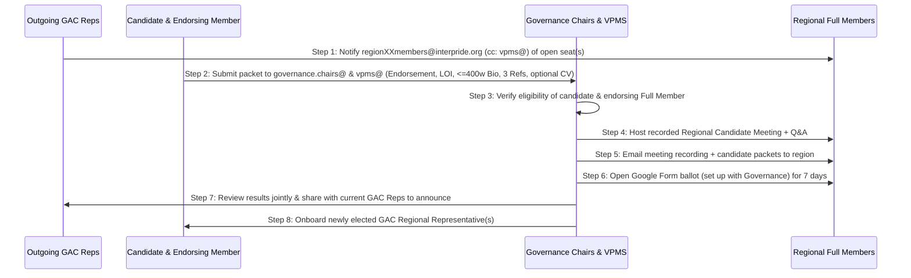

# Elections & Candidate Verification Playbook
{: .no_toc }

**Governing Authorities:**
- [`Bylaws Article V, Sections 12–16` — Nominations, Endorsements & Election of Directors](../bylaws/article-05.html)
- [`Standing Rule 03.09` — Board Officer Elections](../standing-rules/sr-03-09.html)
- [`Standing Rule 03.08` — Electronic Voting Procedures](../standing-rules/sr-03-08.html)
- [`Standing Rule 04.05` — Membership Voting Status](../standing-rules/sr-04-05.html)
- [`GAC Rules & Regulations (Updated July 17, 2026)` — Section 2 (Regional & GAC Board Elections)](../gac/index.html)

---

  
Table of Contents

  {: .text-delta }
- TOC
{:toc}

---

## 1. Board of Directors Election & Verification Checklist (`Bylaws Art. V, Sec. 12–13` & `SR 03.09`)

{: .warning }
> **Crucial Note on `Bylaws Article V, Section 12.B` & `Section 14` (`12.12.2025` PDF Corruption):**
> Because `IP_Bylaws_English_12.12.25.pdf` suffered a copy-paste truncation in `Article V, Section 12.B` and `Section 14`, always consult the **restored `01.20.2024` canonical text** on the [`Bylaws Article V`](../bylaws/article-05.html) page alongside [`SR 03.09`](../standing-rules/sr-03-09.html).

### Step-by-Step Candidate Verification Protocol (Governance Committee + VPMS)
For every candidate nominated for a Board Officer or Vice President position, the **Governance Committee** and **VP of Member Services (`vpms@interpride.org`)** must jointly verify:

1. **Endorsing Organization Eligibility (`Bylaws Art. V, Sec. 13`):**
   - [ ] Is the endorsing organization a **Full Member in good standing** (`SR 04.05`)?
   - [ ] **The 60-Day / March 1 Dues Rule (`Art. V, Sec. 13.F`):** Did the endorsing organization pay its annual membership dues (or receive an approved Solidarity waiver) **at least sixty (60) days prior to March 1** of the election year (or within the timeline specified for special elections)?
   - [ ] **Single-Candidate-Per-Role Cap (`Art. V, Sec. 13.E` — Amended Dec 12, 2025):** Has the endorsing Full Member Organization endorsed **no more than one (1) candidate for that specific officer title** in this election cycle? *(Note: Under the Dec 12, 2025 amendment, the organization may endorse another candidate for a different Board position).*
   - [ ] Is the official **Endorsement Letter** signed by an authorized officer of the Full Member Organization?
2. **Candidate Application Packet Completeness (`Art. V, Sec. 12` & `SR 03.09`):**
   - [ ] Signed **Application / Nomination Form** specifying the exact office sought (and for Co-President candidates, the specific gender-identity seat: **Woman**, **Man**, or **Non-Binary** under `Art. V, Sec. 3`);
   - [ ] **Candidate Biography & Vision Statement** within the prescribed word limits;
   - [ ] **Conflict of Interest Disclosure (`SR 08.10`)** and commitment to execute the [2026 Organization Agreement](../policies/organization-agreement.html);
   - [ ] Confirmation of eligibility under Texas Business Organizations Code §22.221.
3. **Record Date & Voter Roll Certification (August 20, 2026 Minutes Precedent):**
   - [ ] Confirm the **Record Date** (set at **30 days prior to the opening of voting** — e.g., **August 30, 2026** for the 2026 cycle per the August 20, 2026 Governance Committee Minutes) to lock the list of Full Member Organizations in good standing eligible to cast ballots.
4. **Electronic Ballot & Voting Window (`Art. V, Sec. 14` & `SR 03.08`):**
   - [ ] Candidates are presented at the GM&WC Plenary / Candidate Forum;
   - [ ] Electronic voting opens for all eligible Full Member Organizations (`2 votes per Full Member Organization`);
   - [ ] Quorum verification: At least **25% of Full Member Organizations in good standing across at least three (3) Regions** (`Bylaws Art. II.R` & `Art. IV, Sec. 5`).

---

## 2. GAC Regional Representative Election Workflow (`GAC Rules 07.17.2026`)

Under the **July 17, 2026** amendments to the [GAC Rules and Regulations](../gac/index.html), the **Governance Committee (`governance.chairs@interpride.org`)** and **VP of Member Services (`vpms@interpride.org`)** jointly administer all regional elections using this mandatory **8-Step Process**:

### GAC Regional Representative Packet Checklist (`Step 2`):
- [ ] **Endorsement Letter** from a Full Member organization in good standing within the Region;
- [ ] **Letter of Intent** explaining why they want to represent the region, what value they bring, and their qualifications;
- [ ] **Short Biography** (maximum **400 words**);
- [ ] **Three (3) References**;
- [ ] **CV / Resume** *(optional)*.

---

## 3. GAC Board Representative Elections (`GAC Rules Sec. 2` & `Bylaws Art. VII, Sec. 4`)

Three (3) sitting GAC Regional Representatives are elected by the Global Advisory Council to serve on the InterPride Board of Directors (`Bylaws Art. V, Sec. 2.F`):
1. **Eligibility:** Must be a currently serving GAC Regional Representative in good standing.
2. **Application Packet:** Submitted at least **14 days prior to the election** (Bio up to **400 words** per the `07.17.2026` amendment, Letter of Intent, and valid Endorsement Letter).
3. **Voting Threshold:** Elected by a **two-thirds (2/3) supermajority vote** of participating GAC Regional Representatives.
4. **Term:** **Three (3) years**, staggered where possible.
