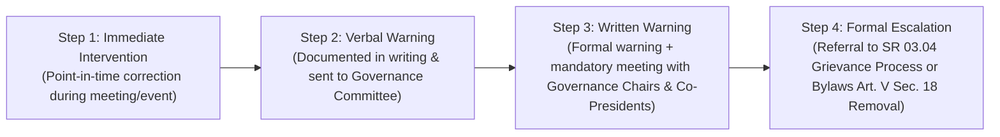

# Ethics, Progressive Discipline, Grievance & Whistleblower Playbook
{: .no_toc }

**Governing Authorities:**
- [`SR 08.04` — Code of Ethics and Conduct (Updated April 6, 2026)](../standing-rules/sr-08-04.html)
- [`SR 03.04` — Grievance Process](../standing-rules/sr-03-04.html)
- [`Bylaws Article V, Section 18` — Resignation and Removal of Directors](../bylaws/article-05.html)
- [`SR 08.10` — Conflict of Interest Policy](../standing-rules/sr-08-10.html)
- [`SR 08.11` — Whistleblower Protection Policy](../standing-rules/sr-08-11.html)
- [`2026 Organization Agreement & Matrix of Confidentiality`](../policies/organization-agreement.html)

---

  
Table of Contents

  {: .text-delta }
- TOC
{:toc}

---

## 1. Quick-Reference Routing Matrix: Which Process Applies?

When an issue, complaint, or disclosure arrives at `governance.chairs@interpride.org` or `grievance.facilitator@interpride.org`, use this matrix to determine the governing pathway and confidentiality tier:

| Situation / Trigger | Governing Rule | Primary Body | Confidentiality Tier | Escalation / Outcome |
| :--- | :--- | :--- | :--- | :--- |
| **Interpersonal conduct, disruptive behavior in meetings/Slack/events, or minor Code of Ethics breach** | [`SR 08.04 Sec 4`](../standing-rules/sr-08-04.html) | Meeting Chair / Governance Co-Chairs & Co-Presidents | **Tier 2** (Governance Confidential) | **Step 1** Immediate Intervention → **Step 2** Verbal Warning (logged with Governance) → **Step 3** Written Warning + Mandatory Meeting → **Step 4** Formal Grievance (`SR 03.04`) or Board Removal (`Art. V, Sec. 18`) |
| **Formal written complaint alleging harm, violation of Bylaws/Standing Rules, or unresolved Step 3 Ethics breach** | [`SR 03.04`](../standing-rules/sr-03-04.html) | Grievance Facilitator (`grievance.facilitator@interpride.org`) & 3–5 Member Grievance Committee | **Tier 1** (Strictly Confidential to Grievance Body; only final decisions/actions summarized to Board) | Intake review → Mandatory ADR / Mediation offer → Formal Grievance Investigation & Hearing → Written Findings & Recommended Sanctions to Board → Appeal |
| **Director / Officer misconduct, breach of fiduciary duty, 3 consecutive unexcused absences, or loss of endorsement** | [`Bylaws Art. V, Sec. 18`](../bylaws/article-05.html) & [`SR 01.01 Sec 5.G`](../standing-rules/sr-01-01.html) | Governance Committee (Verification/Review) & Board of Directors | **Tier 1 / Tier 2** (*In Camera* Board Session) | Written notice of cause → Opportunity to be heard → **2/3 Supermajority vote of the Board of Directors** (excluding the subject Director) |
| **Undisclosed actual or perceived Conflict of Interest** | [`SR 08.10`](../standing-rules/sr-08-10.html) & [2026 Org Agreement](../policies/organization-agreement.html) | Governance Committee Chairs & Co-Presidents | **Tier 2** (Governance Confidential) | Mandatory disclosure review → Recusal from deliberation & vote → Disciplinary action or removal if willfully concealed |
| **Report of financial fraud, unlawful activity, corruption, harassment, or retaliation against a reporter** | [`SR 08.11`](../standing-rules/sr-08-11.html) | Governance Committee Chair or Co-Presidents | **Tier 1** (Strictly Confidential) | Confidential investigation (recusing any implicated person) → Corrective action → Strict protection against retaliation |

---

## 2. The 4-Step Code of Ethics Progressive Discipline Workflow (`SR 08.04 Section 4`)

Adopted on **April 6, 2026**, `SR 08.04 Section 4` provides an early-intervention mechanism before a full `SR 03.04` Grievance is necessary:

### Operational Checklist for Governance Co-Chairs under `SR 08.04`:
1. **Maintain the Confidential Step 2 & Step 3 Ethics Log:** Store all Step 2 verbal warning notifications and Step 3 written warnings in the `Governance - CONFIDENTIAL` Shared Drive.
2. **Conduct Step 3 Mandatory Meetings:** When a Step 3 Written Warning is issued, convene a confidential meeting with the individual, the **Governance Committee Co-Chairs**, and the **Co-Presidents** to establish clear behavioral expectations and a remediation timeline.
3. **Direct Severe Violations Straight to Step 4:** Note that `SR 08.04 Section 4` explicitly permits bypassing Steps 1–3 and proceeding immediately to Step 4 (Formal Grievance or Board Removal) when the severity of the violation warrants immediate action (e.g., harassment, data breach, fraud, or violence).

---

## 3. Formal Grievance Process (`SR 03.04`) — SLA & Step-by-Step Guide

1. **Intake (`grievance.facilitator@interpride.org`):**
   - Verify that the complaint is submitted in writing, identifies the complainant(s) and respondent(s), specifies the alleged violation or harm, and states the desired resolution.
   - Screen for conflicts of interest among the Grievance Facilitator and Governance Co-Chairs.
2. **Alternative Dispute Resolution (ADR) / Mediation Stage:**
   - Before empaneled adjudication, evaluate whether voluntary mediation/ADR is appropriate and accepted by both parties.
3. **Empaneling the Grievance Committee:**
   - Appoint an impartial **Grievance Committee** (free of conflicts of interest with either party or their endorsing organizations).
   - Ensure all Grievance Committee members have executed the **2026 Organization Agreement & Tier 1 Confidentiality Pledge**.
4. **Investigation & Opportunity to Respond:**
   - Provide the respondent with written notice of the grievance and a fair opportunity to submit a written response and supporting evidence.
   - Conduct recorded or documented interviews with witnesses and parties.
5. **Findings, Recommendations & Board Action:**
   - Issue a confidential written report to the Board of Directors (*In Camera*) detailing findings of fact, conclusions under the Bylaws/Standing Rules, and recommended remedies or sanctions.
   - Per the **Matrix of Confidentiality (Tier 1)**, all underlying grievance files are stored exclusively in the `Grievances - Restricted` Shared Drive; only the final decision/action taken is reported in summary form.

---

## 4. Removal of a Director for Cause (`Bylaws Article V, Section 18`)

Under [`Bylaws Article V, Section 18`](../bylaws/article-05.html), a member of the Board of Directors may be removed from office prior to the expiration of their term on the following grounds:
- **Loss of Endorsement (`Art. V, Sec. 13.G` & `Sec. 18`):** If a Director's endorsing Full Member Organization withdraws its endorsement in writing or ceases to be a Full Member in good standing, the Director has a defined cure period to secure a replacement endorsement from an eligible Full Member Organization or vacate the seat.
- **Unexcused Absences (`Art. V, Sec. 18` & `SR 01.01 Sec 5.G`):** Missing **three (3) consecutive regular meetings** without advance notice/excuse triggers automatic Governance review and potential removal.
- **Removal for Cause by the Board (`Art. V, Sec. 18.G`):** Requires written notice of the alleged cause, an opportunity for the Director to be heard before the Board, and an affirmative **two-thirds (2/3) supermajority vote of the Directors then in office** (excluding the Director who is the subject of the removal vote).
