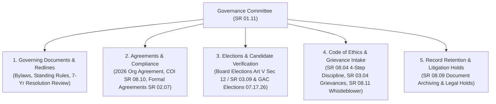

# Governance Committee Co-Chair Hub & Operational Playbooks
{: .no_toc }

**Committee Mandate:** [`Standing Rule 01.11 (Governance Committee)`](../standing-rules/sr-01-11.html) & [`Bylaws Article VIII`](../bylaws/article-08.html)  
**Committee Group Emails:** `governance@interpride.org` | `governance.chairs@interpride.org` | `grievance.facilitator@interpride.org`  
**2026 Co-Chairs:** Chris Robert (`chris.robert@interpride.org`), Artur Maciejewski (`artur.maciejewski@interpride.org`), Morne Claassen-Smit (`morne.claassen-smit@interpride.org`), Chris Grafton  
**Secretary:** Cristal Robinson (`cristal.robinson@interpride.org`) | **Mentor:** Marsha H. Levine (`marsha.levine@interpride.org`)  
**Board Focal Points:** Co-Presidents (`copresidents@interpride.org`)

---

## Constitutional Jurisdiction of the Governance Committee (`SR 01.11`)

Under [`Standing Rule 01.11`](../standing-rules/sr-01-11.html), the **Governance Committee** is a permanent mandatory Standing Committee of InterPride with five core areas of jurisdiction:

---

## Operational Playbooks & 2026 Workplan

1. **[Ethics, Discipline, Grievance & Whistleblower Playbook](ethics-and-grievance-playbook.html)** — Step-by-step operational manual comparing and integrating the 4-Step Code of Ethics accountability workflow (`SR 08.04`), Formal Grievance intake & ADR/Committee hearings (`SR 03.04`), Board Removal for Cause (`Bylaws Art. V, Sec. 18.G`), Conflict of Interest investigations (`SR 08.10`), and Whistleblower investigations (`SR 08.11`).
2. **[Elections & Candidate Verification Playbook](elections-and-verification-playbook.html)** — Complete operational checklists and timelines for Board Officer Candidate Verification (`Bylaws Art. V, Sec. 12–13` & `SR 03.09`), the 60-day pre-March 1 endorsement dues rule, the newly adopted **8-Step GAC Regional Representative Election Process** (`GAC Rules 07.17.26`), and GAC Board Representative 2/3 supermajority elections.
3. **[2026 Governance Committee Minutes, Workplan & Action Tracker](2026-minutes-and-workplan.html)** — Synthesized archive and action tracker from the **April 23, May 14, and August 20, 2026** Governance Committee meetings, including the **August 30, 2026 Record Date**, the **September 30, 2026 Standing Rules Redline Overhaul**, the **USAP Pride Platform Contract termination transition**, and the **Resolution 24-02 Medellín Plenary restoration**.
