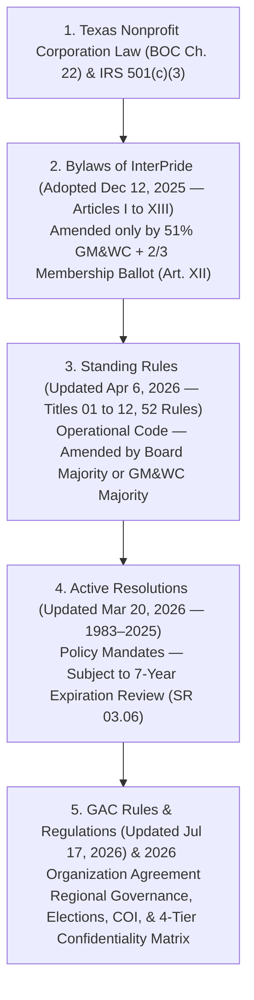

# InterPride Canonical Digital Governance Portal
{: .fs-9 }

**Definitive Digital Edition of InterPride's Bylaws, Standing Rules, Active Resolutions (`1983–2026`), Global Advisory Council (GAC) Rules, Organization Agreements, and Governance Committee Playbooks.**
{: .fs-6 .fw-300 }

[Explore the Bylaws (`12.12.2025`)](bylaws/index.html){: .btn .btn-primary .fs-5 .mb-4 .mb-md-0 .mr-2 }
[Explore Standing Rules (`04.06.2026`)](standing-rules/index.html){: .btn .fs-5 .mb-4 .mb-md-0 .mr-2 }
[Governance Audit & Redline Synthesis](audit/index.html){: .btn .btn-outline .fs-5 .mb-4 .mb-md-0 }

---

## Why This Digital Edition Exists

Between **November 2022 and August 2026**, InterPride's governing framework evolved across **182 separate PDF documents** (140 public files on `interpride.org/resources/` and 42 updated 2025–2026 compendiums, policies, financial filings, and committee minutes distributed via email).

Because the website's `/resources/` page stopped receiving updates in early 2024—and because desktop-publishing layout edits in late 2025 and early 2026 accidentally introduced copy-paste truncations and numbering collisions into several official PDFs—this **Canonical Digital Edition** was engineered for the **InterPride Governance Committee** to provide:

1. **Single Source of Truth (`2025–2026` Editions):** Every current governing document rendered as clean, searchable, deep-linkable Markdown pages.
2. **Restored Text & Inline Errata Callouts:** Wherever a `2025–2026` PDF suffered a layout truncation (such as [`Bylaws Article V, Section 12.B & Section 14`](bylaws/article-05.html) or [`Bylaws Article II.R`](bylaws/article-02.html)), the page displays both the exact `12.12.2025` PDF text and the **restored `01.20.2024` canonical text** inside a high-visibility warning box.
3. **Article-by-Article & Rule-by-Rule Longitudinal Diffs (`2022` → `2023` → `2024` → `2025` → `2026`):** Every Bylaw Article, Standing Rule, Resolution category, and GAC Rule page includes an automated historical diff showing exact additions and deletions across editions.
4. **Operational Playbooks for the Governance Committee:** Ready-to-use workflows and checklists for Ethics & Grievances (`SR 08.04` / `SR 03.04`), Board & GAC Elections (`Art. V, Sec. 12` / `GAC Rules 07.17.26`), and the **Post-September 30, 2026 Standing Rules Redline Synthesis**.

---

## Constitutional Hierarchy of InterPride

---

## Master Currency Table: Website (`2022–2024`) vs. Canonical Edition (`2025–2026`)

| Document Series | Latest Public Website PDF (`interpride.org/resources/`) | Canonical Edition in This Portal (`2025–2026` Email Archive) | Key Structural Changes in `2025–2026` |
| :--- | :--- | :--- | :--- |
| **[Bylaws](bylaws/index.html)** | `01.20.2024` (`IP_Bylaws_Approved_English_01.20.2024.pdf`) | **`12.12.2025`** (`IP_Bylaws_Approved_English_12.12.2025.pdf` — EN/ES/FR/PT) | Updated Co-President gender representation (`Art. V Sec. 1`), 1-year `>=70%` committee service requirement for Board nominees (`Art. V Sec. 12.A`), biennial/virtual GM&WC options (`Art. VIII Sec. 1–2`), and restored PDF layout truncations in `Art. II.R` & `Art. V Sec. 12.B/14`. |
| **[Standing Rules](standing-rules/index.html)** | `10.11.2023` (`IP_Standing-Rules_English_10.11.23.pdf` — 47 rules) | **`04.06.2026`** (`IP_Standing Rules_English_04.06.26.pdf` — **52 rules**) | Added **5 new rules** (`SR 01.12` IGTTF, `SR 02.07` Membership & Pride Platform Fee Schedule, `SR 08.09` Risk Management, `SR 08.10` Conflict of Interest, `SR 08.11` Whistleblower Protection) and overhauled `SR 01.01`, `SR 06.01`, `SR 08.04` (4-step discipline), and `SR 12.01`. |
| **[Resolutions](resolutions/index.html)** | `12.03.2023` (`IP_Resolutions_12.03.22-English.pdf` — through `22-01`) | **`03.20.2026`** (`IP_Resolutions_English_03.20.26.pdf` — through `25-05`) | Added **10 new resolutions** (`23-01`, `23-02`, `24-01`, `24-02`, `24-03`, `25-01`, `25-02`, `25-03`, `25-04`, `25-05`) and restored the Medellín Plenary 3 floor amendments to `Resolution 24-02` on March 20, 2026. |
| **[GAC Rules & Regulations](gac/index.html)** | `01.31.2024` (`IP_GAC_Rules-and-Regulations_English_01.31.24.pdf`) | **`07.17.2026`** (`IP_GAC_Rules and Regulations_English_07.17.26.pdf`) | Established the **8-step Regional Representative election procedure** jointly overseen by `governance.chairs@interpride.org` and `vpms@interpride.org`; raised bio limit to 400 words. |
| **[2026 Org Agreement & Directory](policies/organization-agreement.html)** | *Not published on website* | **`June 2026`** (`IP_Agreement_Board_Chair_GAC_2026.pdf`) | Mandatory annual pledge, 72-hr email SLA, 3-missed-meetings rule, Texas BOC §22.221 fiduciary duties, 4-Tier Matrix of Confidentiality, and June 7, 2026 Roster & Shared Drive Directory. |
| **[Governance Committee Hub](governance-hub/index.html)** | *Internal Committee Records* | **`Apr–Aug 2026`** (`2026-04-23`, `2026-05-14`, `2026-08-20` Minutes) | Playbooks for Ethics/Grievances and Elections, plus the **Aug 30, 2026 Record Date**, **Sept 30, 2026 Standing Rules Redline Overhaul**, and **USAP Pride Platform transition**. |

---

## Quick Navigation by Governance Topic

- **Need to verify a Board or GAC candidate?** → See the **[Elections & Candidate Verification Playbook](governance-hub/elections-and-verification-playbook.html)**, **[Bylaws Article V](bylaws/article-05.html)**, **[SR 03.09](standing-rules/sr-03-09.html)**, and **[GAC Rules (`07.17.2026`)](gac/index.html)**.
- **Handling a Code of Ethics issue, Grievance, Conflict of Interest, or Whistleblower report?** → See the **[Ethics, Grievance & Whistleblower Playbook](governance-hub/ethics-and-grievance-playbook.html)**, **[SR 08.04](standing-rules/sr-08-04.html)**, **[SR 03.04](standing-rules/sr-03-04.html)**, **[SR 08.10](standing-rules/sr-08-10.html)**, and **[SR 08.11](standing-rules/sr-08-11.html)**.
- **Reviewing a Pride Platform contract or membership fee tier?** → See **[SR 02.07 (Payment of Membership Fees & Pride Platforms)](standing-rules/sr-02-07.html)** and the **[2026 Minutes & Workplan (USAP Transition)](governance-hub/2026-minutes-and-workplan.html)**.
- **Synthesizing the post-September 30, 2026 Standing Rules & Bylaws redlines?** → See the **[11-Point Governance Audit & Redline Synthesis](audit/index.html)**.
