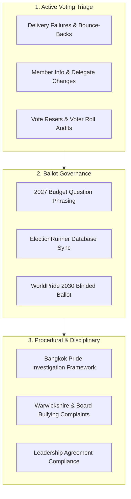

# Governance Committee Status, Cross-Reference Analysis & Action Plan
**Date:** November 6, 2026  
**Subject:** Cross-Reference Audit: Email Correspondence (`emails_audit.jsonl`) vs. Operational Tasks (`project:interpride.governance`)  
**Author:** Governance Committee Working Group  

---

## Executive Summary

Cross-referencing the recent operational email communications (100+ threads in early November 2026) against active Taskwarrior items reveals that the **Governance Committee is simultaneously managing acute election-support operational incidents** and **high-stakes structural/procedural investigations**.

1. **Immediate Balloting Triage:** With the GM&WC 2026 election and WorldPride 2030 voting actively live, the committee has been inundated with member delivery issues, bounce-backs, email corrections, and ballot access problems across international organizations.
2. **Ballot Integrity & Wording Friction:** Late revisions and wording clarification proposals on the 2027 Budget question are creating ambiguity across leadership (J. Andrew Baker, Marsha H. Levine, Chris Robert).
3. **WorldPride 2030 Inquiries & Secrecy:** Inquiries regarding voting access for WorldPride 2030 eligibility, combined with the blinded/restricted voting configuration in ElectionRunner, require formal procedural guidance.
4. **Overdue Core Governance Mandates:** Crucial structural mandates—notably the Bangkok Pride WorldPride 2030 investigation procedural framework, board code-of-conduct reviews, and annual agreement audits—remain open past their late October / early November deadlines.

---

## 1. Deep-Dive Analysis by Domain

### Domain A: Election Operations & Voter Access Triage
* **The Situation:** Live voting launched in the first week of November. Several voting members experienced delivery failures, incorrect contact details, or bounced emails.
* **Correlated Tasks & Email Evidence:**
  * **L'Horgull / PRIDE LH** ([Task #634](file:///Users/chris/Developer/interpride/governance), [Task #633](file:///Users/chris/Developer/interpride/governance)): Roger Presseguer (Pride Barcelona) and Julia Maciocha (EPOA) reported repeated non-receipt of voting emails.
  * **Ethnic Rainbow Alliance NZ** ([Task #626](file:///Users/chris/Developer/interpride/governance)): Non-receipt reported on Nov 5.
  * **Grupo Triângulo Rosa** ([Task #621](file:///Users/chris/Developer/interpride/governance), [Task #622](file:///Users/chris/Developer/interpride/governance)): Delivery issue escalated Nov 6.
  * **Homies Pride Terrassa** ([Task #627](file:///Users/chris/Developer/interpride/governance)): Balloting link missing.
  * **Brussels Pride** ([Task #628](file:///Users/chris/Developer/interpride/governance)): Change of voting delegate to `admin.frank@rainbowhousebrussels.org`, removing outdated contacts (Thierry/Xavier).
  * **Guadalajara Pride** ([Task #632](file:///Users/chris/Developer/interpride/governance)): Email address updated; resend of election ballot access link pending.
  * **Voter Roll Cleanups** ([Task #607](file:///Users/chris/Developer/interpride/governance), [Task #605](file:///Users/chris/Developer/interpride/governance)): Pride Tirol/Innsbruck Pride and Perlen Pride Kufs flagged for removal by JayJay Potter-Peachey.
  * **Vote Reset Protocol** ([Task #623](file:///Users/chris/Developer/interpride/governance)): Request by J. Andrew Baker to contact Tomasz to confirm deletion of erroneous initial vote and re-issue a ballot.

### Domain B: Ballot Verbiage & Interpretation Discrepancies
* **The Situation:** Active discussions occurred between J. Andrew Baker and Marsha H. Levine regarding the phrasing of the budget question on GM&WC ballots.
* **Correlated Tasks & Email Evidence:**
  * [Task #604](file:///Users/chris/Developer/interpride/governance), [Task #635](file:///Users/chris/Developer/interpride/governance), and [Task #636](file:///Users/chris/Developer/interpride/governance): Reviewing the proposal to change *"Do you approve the 2027 Budget?"* to *"Do you confirm the board-approved 2027 budget?"*.
  * *Analysis:* Under InterPride's standard governance practice, the membership confirms the board-approved budget rather than adopting line-item adjustments from the floor. Clarification is required to ensure consistent precedent and member communication.

### Domain C: WorldPride 2030 Inquiries & Blinded Ballot Handling
* **The Situation:** Outside parties and member organizations have inquired about voting eligibility and status. Additionally, the WorldPride voting configuration restricts vote content visibility.
* **Correlated Tasks & Email Evidence:**
  * [Task #620](file:///Users/chris/Developer/interpride/governance): Inquiry from Natchapol Cahloeykul forwarded by Rick Andre regarding eligibility to vote on WorldPride 2030.
  * [Task #629](file:///Users/chris/Developer/interpride/governance): Inquiry from Waiwai Yeo forwarded by Steve Taylor on whether voting has commenced.
  * [Task #624](file:///Users/chris/Developer/interpride/governance) & [Task #625](file:///Users/chris/Developer/interpride/governance): Evaluating the WorldPride voting configuration where ballot selections remain masked to InterPride administrative roles to protect voter privacy and avoid premature outcome leakage.

### Domain D: Structural Mandates & Outstanding Disciplinary Matters
* **The Situation:** While acute voting matters have absorbed committee bandwidth, several significant governance items from late October are overdue.
* **Outstanding Tasks:**
  * [Task #383](file:///Users/chris/Developer/interpride/governance) (Overdue since Oct 28): Formal procedural framework and due process protocol regarding the Bangkok Pride WorldPride 2030 investigation request.
  * [Task #385](file:///Users/chris/Developer/interpride/governance) (Overdue since Nov 2): Formal Code of Conduct review for board meeting bullying complaints and Warwickshire Pride complaints.
  * [Task #384](file:///Users/chris/Developer/interpride/governance) (Overdue since Oct 28): Operational directive delineating GAC representative authority from VPGO outreach and auditing member privacy protections.
  * [Task #386](file:///Users/chris/Developer/interpride/governance) (Overdue since Nov 5): Audit completion of `IP_Agreement_Board_Chair_GAC_2026.pdf` across incoming/continuing leadership.
  * [Task #387](file:///Users/chris/Developer/interpride/governance) (Due Nov 15): Incorporating GM&WC 2026 floor amendments into the master Bylaws within 14 days of conference adjournment.

---

## 2. Status Matrix of Active Governance Tasks

| Task ID | Urgency | Priority | Due Date | Description | Status / Blocker |
| :---: | :---: | :---: | :---: | :--- | :--- |
| **380** | 20.0 | High | Oct 22 | WCAG 2.2 AA visual accessibility & locked LOI verification | Pending (Post-election audit) |
| **381** | 20.0 | High | Oct 23 | Audit ElectionRunner DB vs 686-member voting roll (JayJay) | Ongoing reconcile |
| **382** | 20.0 | High | Oct 24 | Intake desk & translation review for floor resolutions/amendments | Post-plenary consolidation |
| **383** | 17.9 | High | Oct 28 | Bangkok Pride WP2030 investigation procedural framework | **OVERDUE** — High risk |
| **384** | 18.0 | High | Oct 28 | Enforce directive: GAC representative authority vs VPGO | **OVERDUE** |
| **385** | 16.6 | High | Nov 02 | Code of Conduct review: Board meeting bullying & Warwickshire Pride | **OVERDUE** — High risk |
| **386** | 15.2 | High | Nov 05 | Audit `IP_Agreement_Board_Chair_GAC_2026.pdf` signatures | **OVERDUE** |
| **634** | 18.1 | High | Nov 05 | Missing voting email: L'Horgull / PRIDE LH | **Immediate Action** |
| **626** | 17.7 | High | Nov 06 | Missing voting link: Ethnic Rainbow Alliance NZ | **Immediate Action** |
| **624** | 17.7 | High | Nov 06 | Review WorldPride masked vote details & confidentiality | Active today |
| **625** | 15.6 | High | Nov 06 | Spam/delivery diagnostic with JayJay Potter-Peachey | Active today |
| **606** | 15.8 | High | Nov 10 | Confirm voting contact & email for InterPride WC&GM | Active |
| **620** | 15.8 | High | Nov 10 | Clarify WorldPride 2030 eligibility (Natchapol Cahloeykul) | Response pending |
| **631** | 15.1 | Med | Nov 07 | Coordinate with Member Services on missing ballot links | Active collaboration |
| **633** | 14.9 | High | Nov 12 | Verify contact & resend L'Horgull voting link (via Julia/EPOA) | In progress |
| **604** | 13.7 | High | Nov 10 | Review budget ballot wording change proposal (J. Andrew Baker) | Review pending |
| **635** | 8.8 | High | --- | Provide feedback on proposed ballot wording change | Review pending |
| **636** | 9.1 | Med | Dec 31 | Proposed ballot wording review (Marsha H. Levine) | Open review |
| **621** | 8.8 | High | --- | Grupo Triângulo Rosa missing voting link | Needs resolution |
| **627** | 8.8 | High | --- | Homies Pride Terrassa missing voting link | Needs resolution |
| **628** | 8.8 | High | --- | Brussels Pride email correction | Needs database update |
| **632** | 8.8 | High | --- | Guadalajara Pride email correction | Needs database update |
| **623** | 6.7 | High | --- | Tomasz vote cancellation & ballot re-issuance | Coordination needed |
| **607** | 6.7 | High | --- | Remove Pride Tirol & Perlen Pride Kufs from voter roll | Coordination with JayJay |
| **387** | 8.5 | High | Nov 15 | Consolidate floor amendments into Master Bylaws (14-day limit) | Upcoming milestone |
| **388** | 6.2 | Med | Nov 30 | Compile 2026 rulings & procedural precedents into knowledge base | Post-conference |

---

## 3. Recommended Action Plan & Next Steps

### Immediate Priority (Next 24 Hours)
1. **Batch Voter Access Incident Resolutions:**
   * Work with JayJay Potter-Peachey and Gilberto Díaz Kelley (Member Services) in a single operational sync to:
     * Resend voting credentials to **L'Horgull / PRIDE LH**, **Ethnic Rainbow Alliance NZ**, **Homies Pride Terrassa**, and **Grupo Triângulo Rosa**.
     * Update primary voting emails for **Brussels Pride** (`admin.frank@rainbowhousebrussels.org`) and **Guadalajara Pride**.
     * Remove **Pride Tirol** and **Perlen Pride Kufs** from the voting roster.
     * Execute the vote reset protocol for **Tomasz** with written confirmation.
2. **Formally Resolve Ballot Question Wording:**
   * Provide unified Governance Committee confirmation to J. Andrew Baker and Marsha Levine affirming the standardized phrasing: *"Do you confirm the board-approved 2027 budget?"* to eliminate ambiguity.
3. **Draft WorldPride 2030 Inquiries Response Template:**
   * Provide Rick Andre and Steve Taylor with clear, standardized eligibility guidance for inquiries (Natchapol Cahloeykul, Waiwai Yeo) clarifying voting criteria, voting windows, and accreditation requirements.

### Secondary Priority (Next 3–5 Days)
4. **Unblock Overdue Investigation Protocols:**
   * **Bangkok Pride WP2030 Investigation:** Finalize the formal procedural due-process framework (Task #383) to define terms of inquiry, evidentiary standards, and timeline.
   * **Code of Conduct Hearings:** Convene the designated sub-panel to address the formal board meeting bullying complaint and Warwickshire Pride matter (Task #385).
5. **Leadership Agreement Compliance Check:**
   * Review signed copies of `IP_Agreement_Board_Chair_GAC_2026.pdf` (Task #386) to confirm complete onboarding and adherence before incoming leadership assumes workspace authority.

### Post-Conference Milestone (By November 15)
6. **Bylaws Integration:**
   * Aggregate all approved GM&WC 2026 floor amendments and update the master InterPride Bylaws document within the mandatory 14-day statutory timeline (Task #387).
