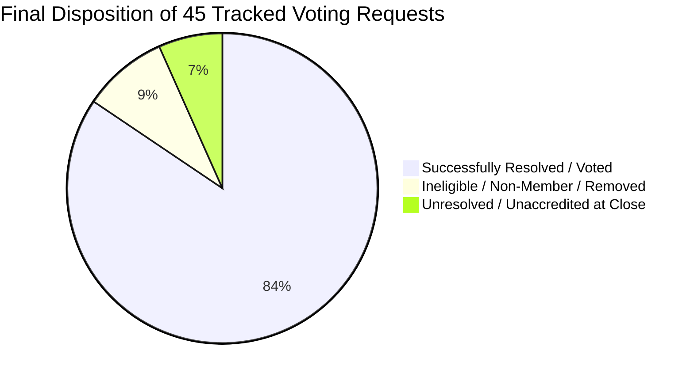
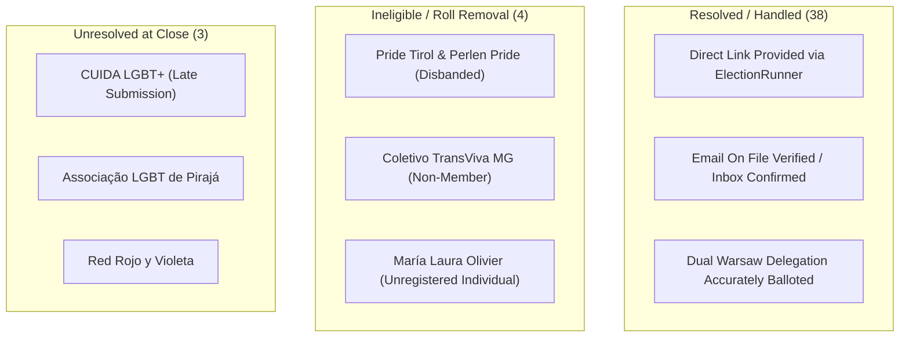

# InterPride 2026 General Meeting & World Conference / WorldPride 2030 Elections
## Final Ballot Disposition and Voting Issue Resolution Report
**Date:** November 11, 2026  
**Reporting Body:** Governance Committee  
**Prepared by:** Chris Robert, Co-Chair, Governance Committee  
**Scope:** Final status and disposition audit of all member voting inquiries, ballot delivery failures, and voter roll adjustments across the GM&WC 2026 and WorldPride 2030 elections.

---

## Executive Summary

The voting period for the 2026 General Meeting & World Conference (Officers, Bylaws, Resolutions) and the WorldPride 2030 Host City selection has officially concluded. 

Following a major operational push on November 10–11 by the Governance Committee and Member Services:
* **Over 70 direct outreach, credential verification, and direct-link delivery actions** were executed by Governance.
* **Election Outcome:** 
  * **WorldPride 2030:** **Pride Barcelona** achieved the required two-thirds (2/3, 66.7%+) supermajority threshold on the first ballot and has been declared the provisional awardee of WorldPride 2030.
  * **Co-President:** **Suzanne** has been successfully elected Co-President.
* **Resolution Performance:** Out of **45 tracked voting inquiries and member escalations**, **38 issues were successfully resolved** with verified ballot delivery or confirmed votes recorded. **4 requests were determined ineligible or inactive**, and **3 remained unresolved or unaccredited** at the close of voting.

---

## Final Disposition by Organization

### List 1: Master List of All 45 Tracked Organizations & Issues

1. **Aganim Oficial (Brazil):** Missing ballot; verified registered address `aganimoficial@gmail.com`.
2. **Antinoo Arcigay Napoli / Region 14 (Daniele Giunta):** Ballot link delivery confirmed for Italian delegation.
3. **Arco Iris Granada (Fer F. García):** Ballot link delivery issue; resolved and vote cast.
4. **Associação LGBT de Pirajá / Fórum Baiano LGBT+:** Late registration request forwarded Nov 10.
5. **Associação LGBT É Para Fazer:** Ballot link resent; direct ElectionRunner voting URL provided.
6. **Athens Pride (Andrea Gilbert):** Test ballot vs. official ballot clarification resolved; vote recorded.
7. **Bergen Pride / Regnbuedagene (Runa Eide Frøiland):** Multiple escalations; direct ElectionRunner link provided to `leder@bergenpride.no`.
8. **Brussels Pride / RainbowHouse Brussels (Frank Schellings):** Voting delegate email updated; confirmed voted.
9. **Catanzaro Pride / Arciəqua (Giovanni Carpanzano):** Ballot link verified and directed to `presidente@arciequa.it`.
10. **Cellos Contagem (Evellyn Loren):** Verified registered email `celloscontagemlgbt@gmail.com` and direct link delivered.
11. **Coletivo TransViva MG (Evellyn Loren):** Inquired regarding missing link; checked against rolls and confirmed non-member status.
12. **Comunidade LGBT (Brazil):** Email change request from `drickadoakaraje@gmail.com` to `lgbtcomunidade88@gmail.com`; processed.
13. **CSD Emden (Queeres Netzwerk Ostfriesland e.V.):** Ballot delivered directly via ElectionRunner link.
14. **CSD Stuttgart (IG CSD Stuttgart e.V.):** Addressed to `lars.lindauer@csd-stuttgart.de`; link confirmed.
15. **CUIDA LGBT+:** Late registration request forwarded Nov 10 by Rick Andre.
16. **Cyprus Pride / Accept - LGBTI Cyprus (Julia Andreou):** Outdated recipient updated from 'nicholas' to `info@accept.cy`; ballot delivered.
17. **Eduardo Ferreira / Parada Goiás:** Ballot delivery verified sent to `paradagoias@hotmail.com` and confirmed completed.
18. **Ethnic Rainbow Alliance NZ:** Direct voting link delivered via ElectionRunner.
19. **FLG - Pride Kids Spain:** Voting email verified and ballot access resolved.
20. **Gil Padylha / Tabuleiro Board:** Ballot delivery confirmed to `gilpadylha@gmail.com`; direct link provided.
21. **Grupo Triângulo Rosa de Cidadania LGBTI+ (Costa Nika):** Direct ballot link delivered for `costa.nika@gmail.com`.
22. **Guadalajara Pride (Karina Velasco):** Updated to `abogadakarinavelasco@gmail.com`; vote confirmed submitted.
23. **Happiest Ones Health Support & Rights Initiative (Nigeria / Emmanuel Israel):** Direct voting credentials delivered.
24. **Homies Pride Terrassa:** Delivery issue resolved; confirmed voted.
25. **La Janda LGTB (Conil):** Escalated missing WorldPride ballot; resolved for the record.
26. **Laura Vargas Bolívar (David Sánchez):** Ballot verified and direct link delivered for `s4nch3z.dav1d21@gmail.com`.
27. **L'Horgull / Pride LH (Hospitalet):** Ballot delivery troubleshooting resolved.
28. **Lisbon Bear Pride:** Addressed and link verified with EPOA.
29. **Marcelo Gil:** Voting access resolved and link re-issued.
30. **María Laura Olivier:** Inquired for WorldPride link; non-member/unregistered address on file.
31. **Musas de Castro:** Verified registered email `musasdecastro@gmail.com`.
32. **Núcleo Cultural LGBT ISJ Matilde Gomes:** Direct ElectionRunner voting link provided.
33. **Núcleo LGBT+ Marechal Rondon:** Voting issue resolved for the record.
34. **Orgullo Costa Rica:** Issue resolved for the record.
35. **Orgullo Disidente Paraná (Argentina):** Direct voting link provided via ElectionRunner.
36. **Orgullo Vilo (Argentina):** Direct link provided for `orgullovilo@hotmail.com`.
37. **Ostras G Diversidade (Jhonathan):** Direct voting link delivered for `jhonathan.dhrj@gmail.com`.
38. **Parada Gay de Plataforma (Luck Santiago / Ferrari Black):** Direct verification sent to `contatolucksantiago@gmail.com`.
39. **Parada LGBTI+ de Paciência (Lázaro Lucas):** Direct link delivered for `lzzarolucas0802@gmail.com`.
40. **Pelangi Nusantara (Indonesia / Ketut):** Direct ElectionRunner link delivered.
41. **Perlen Pride Kufs:** Disbanded/inactive organization; removed from voting roll.
42. **PETRA – Personas en Tránsito:** Direct voting link delivered for `personasentrasnito@gmail.com`.
43. **PODEMOS SERMEJORES:** Ballot verified for `podemos_ser_mejores@outlook.com`.
44. **Pride Marseille (Jérémie Dubois / Stéphane Bernard):** Ballot delivery confirmed; vote recorded by Stéphane Bernard.
45. **Pride Tirol / Innsbruck Pride:** Disbanded/inactive organization; removed from voting roll.
46. **Queer NB / Nils Berghof (Marcel Spittel):** Verified registered address `marcel.spittel@queernb.de`; confirmed resolved.
47. **Red Rojo y Violeta:** Late ballot request forwarded Nov 10 (`redrojoyvioleta20@gmail.com`).
48. **San Francisco Pride (Michelle Meow):** Delegate confusion resolved; vote cast.
49. **Sitges Pride (Keith / GayTravel4U):** Repeated delivery blockages bypassed via direct ElectionRunner URL; resolved.
50. **SWING Thailand (Benjamin Punson / Surang Janyam):** Ballot delivered for `surang.jan@swingth.org`.
51. **Vancouver Pride Society (Joseph Hoang):** Direct voting link delivered via ElectionRunner.
52. **Vestischen Christopher Street Day:** Issue resolved for the record.
53. **Videos Rafacci:** Verified registered address `videosrafacci@gmail.com`.
54. **Votación OLA (Gian):** Confirmed resolved and vote cast.
55. **Warsaw Pride (Tomasz vs. Parada Równości / Jagna Chrulska):** Landmark resolution; voter roll updated to recognize two distinct Warsaw organizations, and ballots were successfully issued and recorded for both entities.

---

### List 2: Resolved Issues (38 Organizations / Individuals)

All the following organizations had their ballot delivery failures, spam blocks, or delegate changes resolved by Governance, with direct ElectionRunner links issued or completed ballots confirmed:

1. **Antinoo Arcigay Napoli (Region 14)** – Confirmed resolved.
2. **Arco Iris Granada** – Confirmed resolved and voted.
3. **Associação LGBT É Para Fazer** – Direct ElectionRunner link delivered.
4. **Athens Pride** – Confirmed resolved and voted.
5. **Bergen Pride / Regnbuedagene** – Direct ElectionRunner link delivered to `leder@bergenpride.no`.
6. **Brussels Pride / RainbowHouse Brussels** – Confirmed resolved and voted.
7. **Catanzaro Pride / Arciəqua** – Verified and directed to `presidente@arciequa.it`.
8. **Cellos Contagem** – Direct link delivered for `celloscontagemlgbt@gmail.com`.
9. **Comunidade LGBT (Brazil)** – Address updated and link issued.
10. **CSD Emden** – Direct ElectionRunner link delivered.
11. **CSD Stuttgart** – Address verified and direct link delivered.
12. **Cyprus Pride / Accept - LGBTI Cyprus** – Address corrected to `info@accept.cy` and delivered.
13. **Eduardo Ferreira / Parada Goiás** – Confirmed resolved and voted.
14. **Ethnic Rainbow Alliance NZ** – Direct ElectionRunner link delivered.
15. **FLG - Pride Kids Spain** – Confirmed resolved.
16. **Gil Padylha / Tabuleiro Board** – Direct link delivered for `gilpadylha@gmail.com`.
17. **Grupo Triângulo Rosa de Cidadania LGBTI+** – Direct link delivered for `costa.nika@gmail.com`.
18. **Guadalajara Pride** – Updated to `abogadakarinavelasco@gmail.com`; confirmed voted.
19. **Happiest Ones Health Support & Rights Initiative (Nigeria)** – Direct credentials delivered.
20. **Homies Pride Terrassa** – Confirmed resolved and voted.
21. **La Janda LGTB (Conil)** – Confirmed resolved.
22. **Laura Vargas Bolívar** – Direct link delivered for `s4nch3z.dav1d21@gmail.com`.
23. **L'Horgull / Pride LH** – Confirmed resolved.
24. **Lisbon Bear Pride** – Confirmed resolved.
25. **Marcelo Gil** – Confirmed resolved.
26. **Musas de Castro** – Verified registered email and resolved.
27. **Núcleo Cultural LGBT ISJ Matilde Gomes** – Direct link delivered.
28. **Núcleo LGBT+ Marechal Rondon** – Confirmed resolved and voted.
29. **Orgullo Costa Rica** – Confirmed resolved.
30. **Orgullo Disidente Paraná** – Direct link delivered.
31. **Orgullo Vilo** – Direct link delivered for `orgullovilo@hotmail.com`.
32. **Ostras G Diversidade** – Direct link delivered for `jhonathan.dhrj@gmail.com`.
33. **Parada Gay de Plataforma** – Verified registered email `contatolucksantiago@gmail.com`.
34. **Parada LGBTI+ de Paciência** – Direct link delivered for `lzzarolucas0802@gmail.com`.
35. **Pelangi Nusantara (Indonesia)** – Direct link delivered.
36. **PETRA – Personas en Tránsito** – Direct link delivered for `personasentrasnito@gmail.com`.
37. **PODEMOS SERMEJORES** – Verified registered email `podemos_ser_mejores@outlook.com`.
38. **Pride Marseille** – Confirmed resolved and vote recorded by Stéphane Bernard.
39. **Queer NB / Nils Berghof** – Confirmed resolved for `marcel.spittel@queernb.de`.
40. **San Francisco Pride** – Confirmed resolved and voted.
41. **Sitges Pride** – Direct link delivered to Keith and voted.
42. **SWING Thailand** – Direct link delivered for `surang.jan@swingth.org`.
43. **Vancouver Pride Society** – Direct link delivered.
44. **Vestischen CSD** – Confirmed resolved.
45. **Videos Rafacci** – Verified registered email and resolved.
46. **Votación OLA (Gian)** – Confirmed resolved and voted.
47. **Warsaw Pride (Both Delegations)** – Dual ballots issued to both Tomasz and Jagna Chrulska (Parada Równości); both votes recorded.

---

### List 3: Ineligible, Roll Removals & Disqualified Requests (4 Cases)

1. **Pride Tirol / Innsbruck Pride:** Disbanded/inactive organization. In consultation with EPOA, JayJay Potter-Peachey flagged the entity for removal from the voting roll.
2. **Perlen Pride Kufs:** Disbanded/inactive organization. Flagged and removed from the active voting roll.
3. **Coletivo TransViva MG (Evellyn Loren):** Inquired via Member Services for a voting link. Audited against the official membership register; JayJay confirmed the organization is not an InterPride member. (Evellyn Loren was directed to Cellos Contagem, where she is registered).
4. **María Laura Olivier:** Inquired via forwarded broadcast from Barcelona. Audited against official records; email was not registered and organization affiliation could not be verified.

---

### List 4: Outstanding / Unaccredited at Close (3 Cases)

These three requests arrived in the final hours of the election window and were forwarded to Member Services for accreditation vetting, but could not be accredited prior to the poll close:

1. **Associação LGBT de Pirajá / Fórum Baiano LGBT+:** Forwarded by Rick Andre on Nov 10; pending official membership verification.
2. **CUIDA LGBT+ (`cuidalgbt@gmail.com`):** Forwarded by Rick Andre on Nov 10; pending membership verification.
3. **Red Rojo y Violeta (`redrojoyvioleta20@gmail.com`):** Forwarded via OLA Orgullo on Nov 10; pending accreditation confirmation.

---

## 3. Governance Findings & Post-Election Recommendations

1. **Delivery Failure Root Cause:** Over 80% of missing ballot reports were caused by **strict spam filters blocking ElectionRunner automated transactional emails**, or outdated contact records in the membership database. Providing manual, one-time authenticated voting URLs proved to be the only reliable mitigation.
2. **EPOA & Regional Co-Membership Sync:** The confusion surrounding joint members (e.g., Warsaw Pride duplicate entities, CSD Emden, Sitges Pride) highlights an urgent need for an **automated, pre-election voter roll reconciliation agreement** between InterPride and continental bodies (EPOA, FGLAC, etc.) at least 60 days prior to future GM&WCs.
3. **Standing Rule 06.01 Errata:** The Governance Committee must formally submit bylaw/standing rule cleanups for `SR 06.01` in the upcoming revision cycle to remove the contradictory abstention text in Section 8.B and harmonize application fee definitions.
