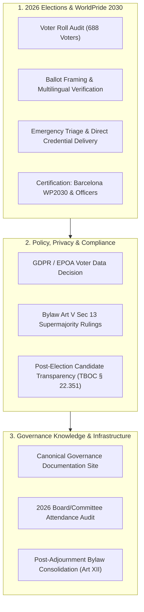

# Governance Committee Activity & Operational Report
**Reporting Body:** Governance Committee  
**Prepared for:** InterPride Board of Directors  
**Co-Chairs:** Chris Robert, Morne Claassen-Smit, Marsha H. Levine  
**Reporting Period:** September 26, 2026 – November 15, 2026  
*(Review Window: Following the September 26, 2026 Board Meeting through the October/November 1 GM&WC in Phuket, Election Conclusion, and Post-Conference Governance Rulings)*  
**Date of Submission:** November 15, 2026  

---

## 1. Executive Summary

The reporting window spanning late September through mid-November 2026 represents the most operationally intensive period for the Governance Committee this year. Following the regular Board meeting on September 26, the scheduled open board sessions during the Annual General Meeting & World Conference (GM&WC) in Phuket on October 30–31 were canceled due to conference schedule constraints and transportation requirements, shifting full operational reporting to the November 21 Board session.

During this period, the Governance Committee:

1. **Administered & Supervised the 2026 GM&WC and WorldPride 2030 Elections:** Successfully certified a record **72.53% turnout (499 / 688 eligible voters)**—the highest participation in InterPride's history.
2. **Executed Acute Voter Delivery Interventions:** Conducted over **70 direct voter-credential resolutions** across **45 tracked escalations** (`38` resolved) to overcome automated mail server bounces and spam filtering blocks across international members.
3. **Certified & Announced Final Election and Plenary Results:**
    * **WorldPride 2030:** **Pride Barcelona** achieved the required two-thirds (2/3, 66.7%+) supermajority on the first ballot.
    * **Executive Board:** **Suzanne Ford** (Co-President, Non-Binary and Gender Diverse), **Mikey Kroeger** (Treasurer), **Cristal Robinson** (VP of Accessibility), **Andrea Covarrubias** (VP of Global Outreach), and **Gregory Rodrigues Roque De Souza** (VP of Global Outreach) were elected, alongside adoption of the **2027 Budget**, **2025 General Meeting Minutes**, and **Resolution 26-01 (Kink & Fetish Caucus)**.
4. **Resolved Multi-Party Electoral Disputes & Privacy Requests:** Arbitrated the Warsaw representation dispute ensuring separate ballots for both Warsaw member organizations, and upheld secret-ballot integrity and GDPR compliance regarding third-party requests for unvoted member lists.
5. **Issued Post-Election Transition & Governance Guidance:** Clarified the mandatory **December 1, 2026** Officer term-transition date under **Bylaws Article V, Sections 14.A & 15.A** in preparation for the November 21 transition Board meeting, and triaged post-election VPGO transparency and conduct inquiries.

---

## 2. Key Activities & Deliverables (By Functional Area)

### A. General Meeting & World Conference (Phuket) and Elections Oversight
* **Ballot Framing & Multilingual Vetting:** Vetted candidate Letters of Intent (LOIs), biographies, and resolution texts across four languages (English, Spanish, French, Portuguese) in preparation for ElectionRunner balloting.
* **Voter Roll & Database Reconciliations:** Audited the voting database against membership records in coordination with Member Services (JayJay Potter-Peachey), vetting proxy allocations and active standing across 688 member organizations.
* **Direct Voter Credential Triage (Nov 4–11):** When automated transactional emails from ElectionRunner encountered strict anti-spam filters globally, Governance initiated intensive manual credential triage, delivering authenticated single-use ballot access links to over 38 member organizations across Europe, Latin America, North America, Africa, and Asia (including *Sitges Pride, Bergen Pride, Vancouver Pride Society, SF Pride, Cyprus Pride, CSD Stuttgart, CSD Emden, Pride Marseille, Pelangi Nusantara, Guadalajara Pride, and Arco Iris Granada*).
* **Warsaw Pride Determination:** Resolved a dual-organization member dispute in Warsaw, affirming that both registered entities (*Tomasz's group* and *Parada Równości / Jagna Chrulska*) were independent members in good standing entitled to separate ballots, successfully preserving the franchise of both.

### B. Electoral Integrity, Secret-Ballot Protection & Post-Election Rulings
* **EPOA Unvoted List Request (Voter Confidentiality & GDPR):** Denied a request to export a list of non-voting European members to an outside regional association during active balloting. Governance ruled that transmitting real-time participation data violated secret-ballot confidentiality, exposed the election to undue influence challenges, and contravened European General Data Protection Regulation (GDPR Article 5) purpose-limitation rules. In lieu of exporting data, Governance authorized a blanket 72-hour reminder broadcast to all members.
* **WorldPride 2030 Voting Procedural Rulings:** Formally clarified the operation of Standing Rule 06.01, Section 8, confirming that a 2/3 supermajority is required on the first ballot, the status of "Do not award" and abstention thresholds, and the fallback simple-majority runoff protocol.
* **Post-Election VPGO Transparency & Conduct Follow-Up (Nov 12–15):** Following post-election inquiries from VPGO-elect **Gregory Rodrigues**, sitting VPGO **Welton Trindade**, and Brazilian affiliates regarding VPGO vote counts and methodology, Governance initiated a reconciliation between InterPride's historical percentage-only public disclosure resolution/practice and Texas Business Organizations Code (`TBOC § 22.351`) inspection standards, and coordinated a formal reminder on `Code of Ethics and Conduct` / `Values Statement` expectations regarding public affiliate WhatsApp commentary.
* **Officer Term Transition Determination (`Art. V, §§ 14.A & 15.A`) (Nov 15):** In response to an Officer term-end inquiry ahead of the November 21 Board meeting, Governance confirmed that because the 2026 GM&WC closed on **November 1, 2026**, the 30-day transition rule under **Bylaws Article V, Section 15.A** (and duplicated in `Section 14.A`) fixes **Tuesday, December 1, 2026** as the legal date outgoing Officers' terms conclude and incoming Officers' terms commence. Governance advised leadership that incoming Officers cannot assume voting seats—nor outgoing Officers be stripped of Board privileges (`Art. V, § 18`)—before December 1, and recommended using the **November 21** Board meeting as a joint orientation, debrief, and handover session bridging the November 21–30 transition window.

### C. Governance Records, Attendance & Bylaw Integration
* **2026 Board & Committee Chair Attendance Audit:** Published the formal 2026 Attendance Report cross-referencing all 2026 board meetings against Standing Rule 01.01 requirements (`≥50%` / at least one Board meeting every two months for Committee Co-Chairs; `66%` for Platforms/GAC; mandatory for Officers).
* **Cross-Reference Audit & Governance Documentation Infrastructure:** Completed the November 6 Governance Cross-Reference Audit and consolidated the canonical digital governing documentation and `Co-President Governance Primer`.
* **Post-Adjournment Bylaw & Resolution Integration:** Initiated post-GM&WC integration under Article XII, including recording adopted **Resolution 26-01 (Kink & Fetish Caucus)** (`97%` approval), the **2027 Budget** (`88%` affirm), and the **2025 General Meeting Minutes** (`99%` favor).

---

## 3. Election Ground-Truth Metrics (ElectionRunner Verification)

Based on the verified ElectionRunner transaction logs (`1794393726`) and the November 12 official outcomes announcement:

| Metric | Official Count | Percentage |
| :--- | :---: | :---: |
| **Total Registered Voter Roll** | **688** | 100.0% |
| **Ballots Successfully Submitted** | **499** | **72.53%** |
| **Logged In But Did Not Submit Ballot** | **25** | 3.63% |
| **Unattempted / Never Logged In** | **164** | 23.84% |
| **Total Successful Authentications** | **884** | — |
| **Automated Bounces / Delivery Failures** | **72** | — |

* **Board Election & Plenary Outcomes (Nov 12 Announcement):**
    * **WorldPride 2030:** **Pride Barcelona** selected (surpassing the 2/3 supermajority threshold on the first ballot).
    * **Co-President (Non-Binary and Gender Diverse):** **Suzanne Ford** elected (`91%`, `64` abstentions).
    * **Treasurer:** **Mikey Kroeger** re-elected (`92%`, `68` abstentions).
    * **Vice President of Accessibility:** **Cristal Robinson** elected (`91%`, `67` abstentions).
    * **Vice Presidents of Global Outreach:** **Andrea Covarrubias** (`74%`, `52` abstentions) and **Gregory Rodrigues Roque De Souza** (`80%`, `119` abstentions) elected.
    * **Plenary Business & Resolutions:** **2027 Budget** affirmed (`88%`, `118` abstentions); **2025 General Meeting Minutes** approved (`99%`, `102` abstentions); **Resolution 26-01 (Kink & Fetish Caucus)** approved (`97%`).

---

## 4. GM&WC Debrief Reflections: What Went Well & Systemic Improvements Needed

### What Went Well
* **Historic Democratic Turnout:** Achieving **72.53% participation (499 ballots)**—assisted by timely manual credential triage (`38` of `45` escalations resolved) and a `6`-hour ballot extension accommodation—demonstrated strong global member engagement when friction is actively managed.
* **Principled Electoral & Privacy Guardrails:** Maintaining firm, documented boundaries on secret-ballot confidentiality (GDPR / EPOA) and dual-member recognition (Warsaw) protected the integrity and defensibility of the election outcomes.
* **Governance Infrastructure Readiness:** Having a unified cross-reference audit and searchable canonical rule set enabled rapid verification of Standing Rule, Resolution, and Bylaws questions during high-pressure conference and post-conference windows.

### Challenges & Systemic Vulnerabilities to Improve
1. **Transactional Email Deliverability:** Over 80% of reported voter issues were traced back to automated transactional emails landing in spam or being rejected outright by local organizational email hosts (`72` automated bounces). Relying solely on automated email blasts for election delivery is a single point of failure.
2. **Co-Membership Roster Synchronization:** Confusion arose regarding dual-membership standing between InterPride and regional bodies (e.g., EPOA, FGLAC). A formal, joint roster freeze and audit should occur at least **60 days prior** to GM&WC.
3. **Bylaws Typesetting Corruption & Transition Timing (`Art. V, §§ 12.B, 14 & 15.A`):** The December 2024/2025 Bylaws PDF layout corruption—where `Section 14.A` was accidentally overwritten with transition text and `Section 12.B` with replacement text—compounded confusion around the 30-day post-GM&WC transition window vs. the November 21 Board meeting schedule. A clean Bylaw amendment cycle is needed both to restore `Sections 12.B` and `14` and, if the Board desires earlier seating with a structured handover period, to amend `Section 15.A` explicitly.
4. **Vote Disclosure Standards Alignment & Standing Rule `06.01` Errata:** Ahead of future elections, Governance and the Board should harmonize any historical percentage-only vote disclosure resolution with `Bylaws Art. V, § 13` and Texas inspection law (`TBOC § 22.351`), and correct the internal contradictions in `SR 06.01` (abstention treatment in `§ 8.B` and conflicting application fee figures in `§§ 1 & 3`).

---

## 5. Governance Action Plan & Priorities (November – December 2026)

1. **November 21 Transition Meeting & December 1 Officer Handover:** Support the November 21 Board meeting as an onboarding/debrief session during the **Nov 21–30 handover period**, formally seating newly elected Officers on **December 1, 2026** per `Bylaws Art. V, § 15.A`, and issue the formal `Art. V, § 15.A` response to VPGO Welton Trindade.
2. **VPGO Clarification & Conduct Follow-Ups:** Deliver the formal written clarification on VPGO vote-percentage calculation to Welton Trindade (cc'ing Andrea Covarrubias, Gregory Rodrigues, Governance Co-Chairs, and Co-Presidents) alongside a separate Board Agreement / `Code of Ethics and Conduct` reminder regarding affiliate WhatsApp channels.
3. **Bylaw Master Document & Amendment Package:** Complete integration of `2026` GM&WC outcomes (`Resolution 26-01`, 2027 Budget, 2025 Minutes) and draft the `2027` corrective Bylaws/Standing Rules amendment package (`Art. V §§ 12.B, 14, 15.A` and `SR 06.01`).
4. **Outstanding Due Process & Code of Conduct Reviews:** Finalize the procedural due-process framework regarding the Bangkok Pride WorldPride 2030 inquiry and conclude preliminary reviews of outstanding Code of Conduct complaints under `SR 08.04`.
5. **Onboarding, Leadership Agreements & SSO Evaluation:** Audit executed copies of `IP_Agreement_Board_Chair_GAC_2026.pdf` across incoming Board members and Committee Co-Chairs prior to December 1, and coordinate with the Tech Committee on migrating election credential delivery to an authenticated SSO member portal.

---

*Respectfully submitted,*  
**Governance Committee**  
Chris Robert, Co-Chair  
Morne Claassen-Smit, Co-Chair  
Marsha H. Levine, Co-Chair
